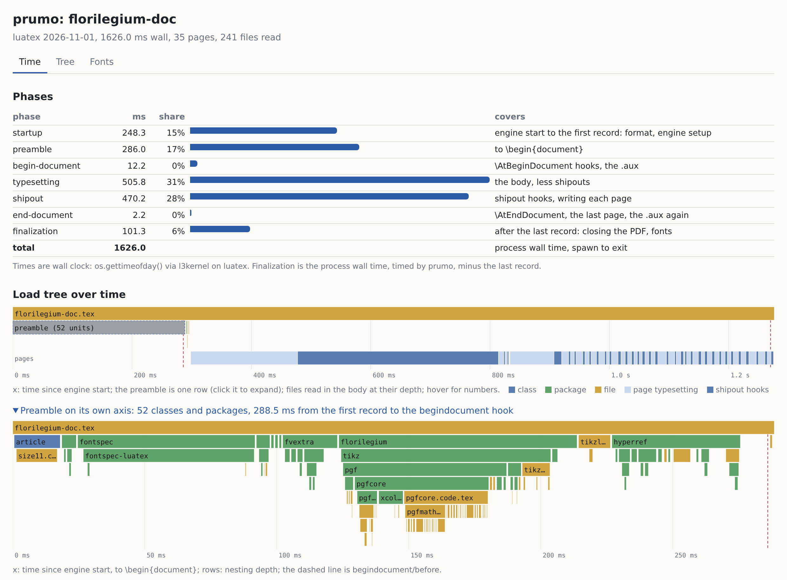

# prumo

*prumo* (Portuguese: plumb line) is a build analyzer for LaTeX. One instrumented compile tells
you where the time goes, package by package. It also tells you which package loaded which,
which fonts were loaded but never used, and exactly which TeX Live packages your documents
need. A second, slower pass finds the `\usepackage` lines you can delete.

It is not a compiler and not an editor. It sits next to whatever you already use (`pdflatex`,
`latexmk`, TeXstudio) and reads what the build leaves behind.

## Origin

I made this while working on [florilegium](https://github.com/kevinraymond/florilegium) and as
I learn more about LaTeX, LuaTeX and the hook system. The manual kept taking longer to build and
I had no way to see why. Commenting packages out one at a time is not insight. prumo
is one instrumented build that shows where the time goes, which package loaded which, and what you can
drop.

It has been run on my own corpus and on a few public documents (a thesis template, a beamer
deck, a 76-page arXiv paper; see [the benchmarks](docs/benchmarks/README.md)). Please report
what breaks!

This project was made with the assistance of AI (Claude).

## Install

prumo is one binary. It needs a TeX installation to measure (TeX Live or MiKTeX) and
`pdffonts` from poppler-utils for the fonts report. `prumo doctor` tells you what it found.

Linux and macOS:

```
curl -fsSL https://github.com/kevinraymond/prumo/raw/main/install.sh | sh
```

Windows, in PowerShell:

```
irm https://github.com/kevinraymond/prumo/raw/main/install.ps1 | iex
```

The scripts download the binary for your machine from the latest release, check its sha256, and put
it in `~/.local/bin` or `%LOCALAPPDATA%\Programs\prumo`. They say so if that directory is not
on your `PATH` (the PowerShell one adds it). `PRUMO_VERSION` picks a release and
`PRUMO_INSTALL_DIR` a directory. The other ways in: `cargo install prumo` (Rust 1.88 or
newer), the archives on the [release page](https://github.com/kevinraymond/prumo/releases)
by hand, or the Docker image below when there is no TeX at all.

## Usage

```
prumo doctor                         # what this machine can do
prumo time main.tex                  # per-package, per-file, per-page time; builds and caches. In a terminal: timeline, bars, page strip (--preamble expands the preamble, --plain for text)
prumo time main.tex --json           # schema 1, the stable API
prumo time main.tex --html           # one self-contained page: flame chart, tree, fonts (./main-prumo.html)
prumo time main.tex --engine lualatex --latexmk --by package --top 20   # --engine defaults to the % !TEX program line, else pdflatex
prumo time main.tex --build 'latexmk -pdf -shell-escape -outdir=build'   # your own build command
prumo graph main.tex --dot | dot -Tsvg > graph.svg   # which package loaded which
prumo compare main.tex               # the same document on pdflatex, xelatex and lualatex, one table
prumo fonts main.tex                 # loaded vs embedded, Type 3 warnings, which package loaded each family
prumo packages main.tex              # the tlmgr packages this document needs, and why
prumo prune docs/ --engines pdflatex # corpus-wide keep list and tlmgr remove plan (dry run)
prumo prune docs/ --apply --yes      # run the plan; every tlmgr command is logged
prumo unused main.tex                # which \usepackage lines can go: remove the line, rebuild, compare
prumo unused obra.cls --corpus 'docs/**/*.tex'   # a class judged against every document that uses it
prumo time main.tex --env tblr,minted  # which environments to time (default: tikzpicture, axis, tcolorbox, tblr, longtable, tabularx, minted, lstlisting, forest)
prumo time output.prumo              # records from a build prumo did not run (Overleaf: docs/overleaf.md)
prumo doctor --check-log main.tex    # files that bypassed the hooks; log vs records
prumo where main.tex                 # where this document's artifacts are
prumo clean [--stale] [--yes]        # what the cache holds; delete it (all, or only gone documents)
```

Here is `prumo time main.tex --html` on florilegium's manual (LuaLaTeX, 37 pages). The top
chart is the whole build with the preamble folded into one row. Click that row and the
preamble opens on its own axis, one row per nesting depth.



Everything the instrumented build leaves behind goes to your cache directory: `~/.cache/prumo`
on Linux, `~/Library/Caches/prumo` on macOS, `%LOCALAPPDATA%\prumo` on Windows. `PRUMO_CACHE`
moves it and `--out` picks a place for one run. Every command prints the directory it used,
and `prumo where main.tex` will tell you again later. Nothing is written next to your document.

## What `time` and `compare` print

`prumo time main.tex --engine lualatex --plain` on the five-page paper from the
[benchmarks](docs/benchmarks/README.md) (TeX Live 2026, i9-13900K; the load tree that
follows is cut here):

```
== prumo report: main  (1379 ms wall, luatex 2026-11-01, 5 pages, 313 files read)

-- phases --  wall clock (os.gettimeofday() via l3kernel); finalization timed by prumo
  startup             238.1 ms   17%  engine start to the first record: format, engine setup
  preamble            750.3 ms   54%  to \begin{document}
  begin-document       52.1 ms    3%  \AtBeginDocument hooks, the .aux
  typesetting         202.0 ms   14%  the body, less shipouts
  shipout              63.4 ms    4%  shipout hooks, writing each page
  end-document          3.3 ms    0%  \AtEndDocument, the last page, the .aux again
  finalization         69.8 ms    5%  after the last record: closing the PDF, fonts
  total              1379.1 ms        process wall time, spawn to exit

-- slowest units (exclusive) --
    337.6 ms   1071.2 ms incl  file main.tex
    283.4 ms    294.1 ms incl  pkg  biblatex
     80.4 ms     88.2 ms incl  pkg  pgfplots
     65.6 ms     66.7 ms incl  pkg  fontspec-luatex
     34.2 ms     49.7 ms incl  pkg  siunitx
     15.6 ms     46.1 ms incl  pkg  hyperref
     10.1 ms     10.1 ms incl  file size11.clo
     10.1 ms     14.2 ms incl  pkg  lipsum
  hint: biblatex is 39% of your preamble; it is loaded by main.tex. 338 ms is in main.tex itself, outside any package.

-- environments --  \begin to \end, less shipouts; a nested one counts in its parent too
       54.8 ms     2×  slowest    39.1 ms  tikzpicture
       38.6 ms     1×  slowest    38.6 ms  axis

-- pages --
  page 1: 99.0 ms  (typesetting 56.0 ms, shipout 43.1 ms)
  page 2: 43.0 ms  (typesetting 37.7 ms, shipout 5.3 ms)
  page 3: 58.2 ms  (typesetting 54.0 ms, shipout 4.1 ms)
  page 4: 22.5 ms  (typesetting 16.8 ms, shipout 5.6 ms)
  page 5: 43.8 ms  (typesetting 38.5 ms, shipout 5.3 ms)
  hint: page 1 carries font loading and first-shipout setup (99.0 ms); later pages average 41.8 ms
```

In a terminal the same report starts with a timeline of the build and puts a bar next to each
row. `prumo compare main.tex --runs 4` on the same paper:

```
== prumo compare: main  (4 runs per engine, the first is a warm-up, the median of the rest is reported)
  engine          wall pages  slowest unit (excl)            page 1    first run
  pdflatex      852 ms      5  biblatex 134.6 ms             75.2 ms       832 ms
  xelatex      1155 ms      5  biblatex 250.5 ms             36.1 ms      4050 ms
  lualatex     1338 ms      5  biblatex 269.6 ms             97.0 ms      1342 ms

-- phases (ms) --  wall clock: pdflatex \pdfelapsedtime, xelatex \elapsedtime, lualatex os.gettimeofday() via l3kernel
                    pdflatex    xelatex   lualatex
  startup               42.4       81.9      239.4
  preamble             500.2      698.0      720.2
  begin-document        48.8       45.2       49.4
  typesetting          147.2      255.8      194.9
  shipout               59.3       18.0       62.1
  end-document           2.3        2.5        3.3
  finalization          52.0       53.5       68.6
  total (wall)         852.1     1155.0     1337.9
  hint: pdflatex is fastest for this document; lualatex takes 486 ms more (1.6×).
  note: xelatex's first run took 4050 ms (font cache build); the reported run is warm.
```

## Running from Docker, nothing installed

No TeX Live? No Rust? `docker/Dockerfile.user` builds an image with a full TeX Live, Poppler,
warm font caches and prumo as the entrypoint. The `docker/prumo` script runs it as a command.
Copy it somewhere on your `PATH` and you are done:

```
curl -fsSL https://github.com/kevinraymond/prumo/raw/main/docker/prumo -o ~/.local/bin/prumo
chmod +x ~/.local/bin/prumo
cd ~/thesis               # the directory your document is in
prumo time main.tex
```

Nothing goes into your shell's startup files. The script is twenty lines of `sh` that type the
`docker run` line for you. Here is what that line does:

- Mounts the current directory and your prumo cache directory inside the container at the same
  paths they have on your machine. Printed paths are yours, runs survive the container, and
  `prumo clean` sees them.
- Runs the container as you, so the files it writes are yours too.
- Gives Docker a terminal only when stdout is one. `time` draws its charts at the prompt, and
  `prumo time --json | jq` stays clean.

The container sees only the current directory, so run it from the one your document is in.
`PRUMO_IMAGE` picks the image (a local build, the `small` tag), `PRUMO_CACHE` the cache
directory, `PRUMO_DOCKER=podman` another engine, and `PRUMO_DOCKER_OPTS` adds options to
`docker run`.

On Windows, `docker/prumo.cmd` is the same command for Docker Desktop. Save it in a directory
on your `PATH`. It mounts `C:\Users\you\thesis` at `/C/Users/you/thesis` and prumo prints the
Windows names back (the cache is in `%LOCALAPPDATA%\prumo`). I have not tried the `.cmd`
with a real Docker Desktop yet. The native binary is tested on Windows.

Without the script, the one-off form works too. The image then keeps its cache in `.prumo/`
under the mounted directory, because its own cache directory vanishes with the container:

```
docker run --rm --user "$(id -u):$(id -g)" -v "$PWD:/doc" ghcr.io/kevinraymond/prumo time main.tex
```

Two flavors of image. `latest` and `X.Y.Z` carry a full TeX Live, about 5 GB on disk, and
should compile anything. `small` and `X.Y.Z-small` carry scheme-small, under 1 GB, and
compile most everyday documents. If yours fails on `small`, move up. Both are built for x86-64
and arm64, so Apple silicon runs them natively. Want to build it yourself?
`docker build -t prumo -f docker/Dockerfile.user .` compiles prumo inside the build, nothing
to install first, and `PRUMO_IMAGE=prumo` points the script at it.

What changes inside the image: nothing for `time`, `graph`, `fonts` and `compare`, since they
are about your document. `packages` gives the same package names any TeX Live uses. `prune`
describes the image's installation, not yours, so `--apply` makes no sense there. Its
`keep.txt` and `install-tl` profile are still the useful part: the minimal TeX Live your
documents need, ready to install from scratch. `doctor` and every build say they run in the
image, and `doctor` says what the image can see of your machine. The command hides
`docker run`, not the fact that the TeX Live being measured is the image's.

## How it works

A ~190-line probe package, `tex/prumo.sty`, is loaded ahead of `\documentclass`:

```
TEXINPUTS=tex: pdflatex -recorder -jobname=main "\RequirePackage{prumo}\PrumoEnvironments{tikzpicture}\input{main}"
```

It only listens to the LaTeX hook management system and writes one event per line to
`main.prumo`: files, packages and classes opening and closing, the steps of
`\begin{document}` and `\end{document}`, each shipout, and the environments it was asked to
watch. It never changes typesetting: the PDF is byte-identical with and without it, on all
three engines, and that is a test. prumo reads that record, the engine's `-recorder` file list
(`main.fls`) and the PDF into one model and reports from there.

The reference analyzer, `scripts/prumo_report.py`, is the oracle the Rust implementation must
match; its output on the fixtures is frozen under `fixtures/*/artifacts/`.

## How time is measured

Every record carries `\sys_timer:`, the LaTeX kernel's timer, in units of 1/65536 s. It is
wall clock on all three engines: `\pdfelapsedtime` on pdfTeX, `\elapsedtime` on XeTeX, and on
LuaTeX a reading of `os.gettimeofday()`. On LuaTeX the kernel sets the timer's zero when its
Lua code loads, to `gettimeofday() - os.clock()`; `os.clock()` only moves that zero back to
about the start of the process. On every engine the first record's timer matches the time
from spawning the process to the record file appearing, within 5 ms (file timestamps there
move in 4 ms steps), so the zero is the process start.

prumo also times the engine process itself, from spawn to exit, to the millisecond. The
difference between that and the last record is the finalization: what the engine does after
`\end{document}` has run, closing the PDF and writing the fonts into it (on XeTeX,
xdvipdfmx). Under latexmk there is no single process to time, so there is no finalization
either, and the report says so.

The phases (`prumo time` shows them first) cut the run at the records:

| phase | from | to |
|---|---|---|
| startup | process start | the first record: format loading, engine setup |
| preamble | the first record | `\begin{document}` starts |
| begin-document | `\begin{document}` starts | it ends: `\AtBeginDocument` code, the `.aux` |
| typesetting | `\begin{document}` ends | `\end{document}` starts, less shipouts |
| shipout | every `shipout/before` | its `shipout/after`: shipout hooks, the page written |
| end-document | `\end{document}` starts | the last record, less shipouts |
| finalization | the last record | process exit |

The seven add up to the wall time. A first build on a new machine or after a TeX Live update
builds font caches (luaotfload's name database on LuaTeX, fontconfig on XeTeX) and can take
seconds longer; `compare` runs every engine twice for that reason, and the
[benchmarks](docs/benchmarks/README.md) give cold and warm numbers.

## How this differs

- **It runs on the TeX Live you already have.** The probe is plain LaTeX hooks, so pdfTeX,
  XeTeX and LuaTeX all report the same way, and the numbers are from your real build, with
  your fonts, your class, your `latexmkrc`. An engine with profiling built in can only measure
  itself. prumo can compare any engine that runs LaTeX hooks and `-recorder` to the others on
  your document.
- **It wraps, it does not replace.** `latexmk` still drives the build (`--latexmk`, or your own
  command with `--build`), `tlmgr` still installs and removes packages (prumo prints the
  commands, and runs them only behind `--apply --yes`), your editor still compiles.
- **Package and page, not macro.** For per-line and per-macro profiling there is `texprof`
  (below). prumo answers the questions before that one: which package, which file, which
  page, which environment, which font, which `\usepackage` line.
- **Experiments, not guesses.** "Unused" means the document was rebuilt without the request and
  nothing observable changed: page count, text, a coarse render. The caveat is printed with it.

## Related tools

These are the tools I know of that touch the same questions. Each was installed and run on
TeX Live 2026 (November 2026) before I described it here.

- **texprof and texprofile** (Martin Ruckert, TUGboat 45:2, 2024; in TeX Live, in the `hitex`
  package). texprof is a TeX engine of its own, Knuth's TeX with e-TeX and Prote, and it
  writes DVI. It timestamps every command and charges the time to the file and line the
  command came from, a macro's to where it was defined. texprofile prints the tables and a
  call graph.
- **latexpkges3** (Python, on PyPI since 2021, a fork of LaTeXpkges from 2015). Removes each
  `\usepackage` in the main file's preamble in turn, rebuilds, and compares an MD5 of the
  output. By design it looks only at the main file's top level.
- **stygtfo** (Python, on PyPI since 2022). The same idea: comments out each `\usepackage`
  line, rebuilds, and compares the rendered pages. Its README says it was tested with tectonic
  only.
- **latex-dependency-grapher** (Java, CTAN, 2024). Scans the source for `\usepackage`,
  `\RequirePackage`, `\input` and `\include`, finds each file with kpsewhich and draws the
  graph with Graphviz. For unneeded packages it comments out each line and checks that
  pdflatex still exits 0.
- **texfindpkg** (texlua, CTAN, in TeX Live and MiKTeX). Tells you which package provides a
  file, a command or an environment and what it depends on, and installs it. Its data comes
  from TeXstudio's completion files. It does not look at a build.
- **TinyTeX** (Yihui Xie). A small TeX Live, about 100 packages in the default bundle, whose
  R package installs what is missing by reading the log of a failed run.
- **texliveonfly** (2011, in TeX Live). Runs the compiler and installs whatever the "File not
  found" errors name, until the build gets through.
- **mkjobtexmf** (Heiko Oberdiek, 2011, in TeX Live). Collects the files one run read, from
  `-recorder` or strace, into a texmf tree for that job.

prumo's answers come from hooks on the build you already run, on any of the three engines.
The package graph is what the hooks saw load, not what the source text names. `unused`
compares page count, text and a coarse render, not a checksum or an exit code. The package
list is the files the engine read, mapped through your `texlive.tlpdb`. The installers above
add what is missing; `prune` subtracts what a corpus does not use.

### Why not texprof

texprof answers a finer question: which line, which macro. It does that by being the engine,
so what it measures is texprof running your document, not pdfTeX, XeTeX or LuaTeX, and the
output is DVI. On TeX Live 2026 I could not build it a LaTeX format: `texprof -ini -ltx
latexprof.ini` overflows its macro stack in the 2026-11-01 kernel's `expl3-code.tex`, and TeX
Live ships no texprof formats. Plain TeX works. prumo stays outside the engine. It is a
package of hooks on the engine you already use, so the numbers are your build's, at the grain
of packages, files, pages and environments. When prumo points at a package and you want to
know which of its macros, that is texprof's question.

## What it will not do

- Profile macros. prumo stops at package, file, page and environment; `texprof` goes below
  that.
- Change your build. The probe adds hooks and writes one record file; the PDF is
  byte-identical with and without it, and that is a test.
- Touch your files. Builds run on a copy; artifacts go to your cache directory (or whatever
  `--out` says), nothing next to your document. `prune --apply` is the one destructive command, it
  re-prints its plan first and needs `--yes`.
- Fetch anything. It reads the local `texlive.tlpdb`; no network, ever.
- Prove a package unused. "No observable effect" means this document, this build, these
  comparisons; a package can matter for input the document does not exercise, and the report
  says so every time.
- Resolve system fonts on XeTeX. XeTeX opens OpenType fonts outside kpathsea, so the loaded
  side of the fonts report stops at what the PDF says; LuaTeX's are paired through luaotfload.
- Plan a `prune` on MiKTeX. MiKTeX has no `texlive.tlpdb`, so `packages` reports files, not
  packages, and `prune` has nothing to work from. Everything else runs there (tested on
  MiKTeX 25.12, Windows 10).

## Building

```
cargo build
cargo test                      # parsers against checked-in artifacts; no TeX needed
cargo test --features tex       # fixtures through a real engine (needs TeX Live + poppler)
scripts/tex_tests.sh            # the same, inside the Docker image, when the host has no TeX
```

Regenerating the artifacts needs TeX Live and poppler-utils; the image in
`docker/Dockerfile.tex` has exactly that:

```
docker build -t prumo-tex -f docker/Dockerfile.tex .
docker run --rm --user "$(id -u):$(id -g)" -v "$PWD:/w" -w /w prumo-tex bash scripts/make_artifacts.sh
```

## Documentation

`docs/` holds the design: vision, prior art, architecture, the probe, package resolution and
pruning, unused-package detection, phases, open questions, a glossary, and the lab notes of
what was verified on which TeX Live.

## License

The Rust code is licensed under either of Apache License, Version 2.0 (`LICENSE-APACHE`) or
MIT license (`LICENSE-MIT`) at your option. `tex/prumo.sty` is additionally available under
the LaTeX Project Public License 1.3c, so it can be distributed on CTAN on its own.
