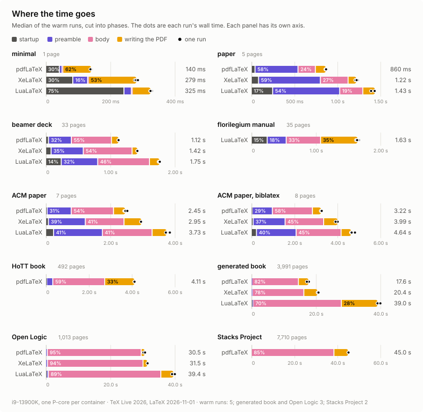
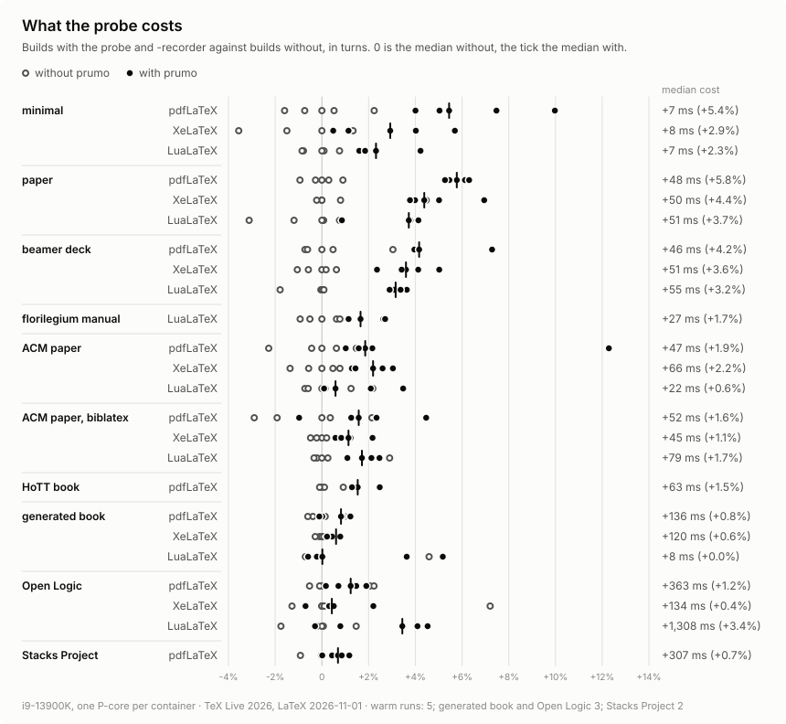
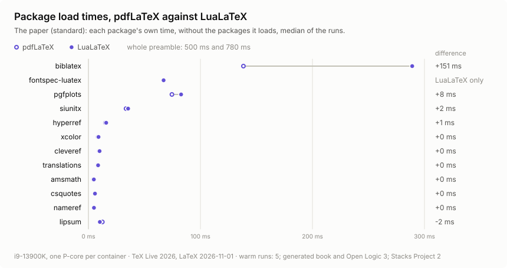
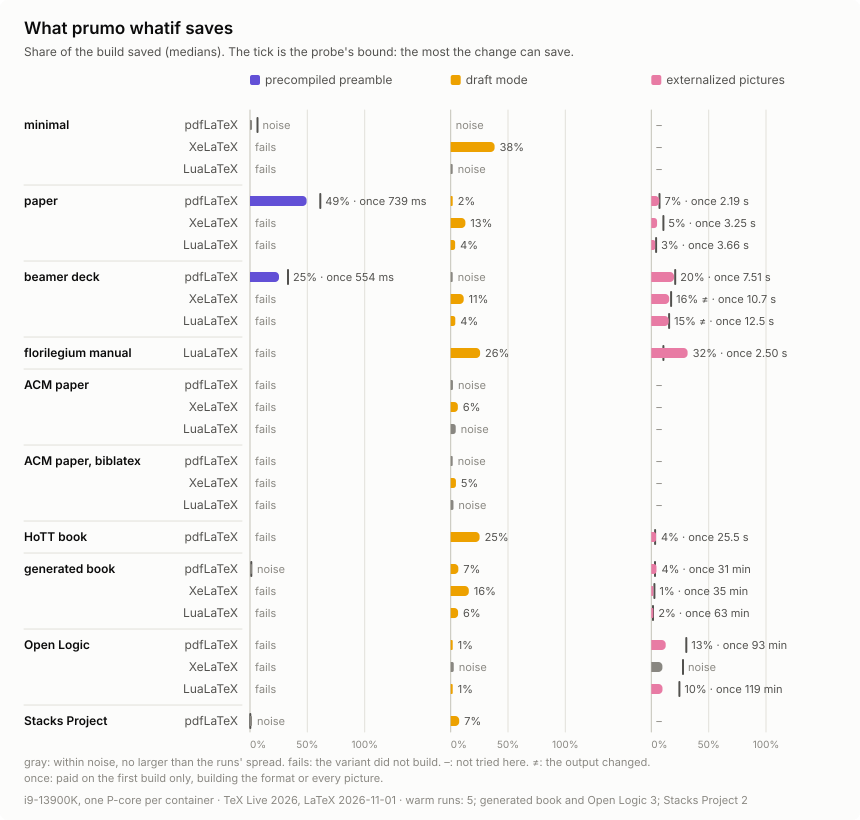

# Benchmarks

Where a LaTeX run spends its time, what prumo's probe costs, and what `prumo whatif`'s three
speed-ups save, on ten documents and three engines. Every number here comes from prumo's
own JSON, and the scripts that made them are in this directory, so you can run them on your
machine and compare.

## The documents

| document (`--docs` name) | what | pages | engines | from |
|---|---|---:|---|---|
| minimal (`minimal`) | `\documentclass{article}`, one word. The startup test. | 1 | all three | here |
| paper (`standard`) | A paper: amsmath, siunitx, TikZ, pgfplots, microtype, hyperref, cleveref, biblatex with biber; fontspec on XeLaTeX and LuaLaTeX. | 5 | all three | here |
| ACM paper (`acmart`) | ACM's `sigconf` sample with BibTeX, a tagged PDF (`\DocumentMetadata`). | 7 | all three | [acmart](https://github.com/borisveytsman/acmart/tree/0537b243395b23ad85c5036929f4b1f28429b3a5) `0537b24`, LPPL 1.3c |
| ACM paper, biblatex (`acmart-biblatex`) | The same sample with biblatex and biber. | 8 | all three | the same |
| beamer deck (`metropolis`) | The metropolis beamer theme's demo deck. | 33 | all three | [mtheme](https://github.com/matze/mtheme/tree/2fa6084b9d34fec9d2d5470eb9a17d0bf712b6c8) `2fa6084`, CC BY-SA 4.0 |
| florilegium manual (`florilegium`) | The manual of florilegium, a Lua package. | 35 | LuaLaTeX | [florilegium](https://github.com/kevinraymond/florilegium/tree/833c4fc9ff776c51d0609fd6c96b4a2868806efa) `833c4fc`, MIT |
| HoTT book (`hott`) | The HoTT book. | 492 | pdfLaTeX | [HoTT/book](https://github.com/HoTT/book/tree/578b85cc8d586b1677ec4335148adeb443057d24) `578b85c`, CC BY-SA 3.0 |
| Open Logic (`open-logic`) | The Open Logic Project's complete text. | 1,013 | all three | [OpenLogic](https://github.com/OpenLogicProject/OpenLogic/tree/1e960beff9ed7835bf3e3f1335e21af3439cd107) `1e960be`, CC BY 4.0 |
| generated book (`large`) | A book `gen_large.py` writes: 140 chapters, 2,800 sections of lipsum, an equation and a cross-reference in each, a table every fifth section, a TikZ picture per chapter. | 3,991 | all three | here |
| Stacks Project (`stacks`) | The Stacks Project as one book. | 7,710 | pdfLaTeX | [stacks-project](https://github.com/stacks/stacks-project/tree/a04446e57ec1fbc252a871afcec7752fb2807b14) `a04446e`, GFDL 1.2 |

Three of them live in this repository. The other seven are taken from their own repositories
at the commit above and are never stored here. Their licenses are their own, and share-alike
and GFDL terms do not mix with this repository's. `corpus.toml` lists every document with its
commit, its license, the engines it builds on and the step that prepares it (acmart builds
its class and samples from `.dtx` files, the Stacks Project writes its book file, the HoTT
book its version file).
`fetch.py` lays them out and keeps the clones in `~/.cache/prumo-bench`.

The HoTT book builds on pdfLaTeX only (xypdf needs pdfTeX). The Stacks Project runs on
pdfLaTeX only, the engine its own build uses, because the other two would triple the longest
run. On XeLaTeX and LuaLaTeX, the ACM paper has one page fewer than on pdfLaTeX and Open Logic
two.

kaobook was tried and left out. All of its examples fail on TeX Live 2026 with `Command
\c@proposition already defined`, and so does a five-line document with amsthm and thmtools'
`sibling=` key. thmtools 0.76 and the 2026-11-01 kernel do not get along.

## How they were run

- **Machine:** Intel Core i9-13900K, Debian 13, Linux 6.12. Each run is a container pinned to
  one performance core; TeX is single-threaded. This set ran on seven of the eight
  performance cores at once: the phases on one, the `whatif` and overhead runs on the
  others. The phase numbers came out 0.3 to 5% slower than an earlier run on a quieter
  machine. The `whatif` and overhead comparisons are made inside one container, build
  against build in turns, so the other cores do not tilt them.
- **TeX:** TeX Live 2026 from `texlive/texlive:latest` plus Poppler (the
  `prumo-dev:tl2026-full` image `make verify-prune` builds): pdfTeX 1.40.29, XeTeX
  0.999998, LuaHBTeX 1.24.0, LaTeX 2026-11-01.
- **Each timed run** is one engine pass on a copy of the document whose `.aux`, `.toc` and
  `.bbl` came from a latexmk build just before, the way an editor rebuilds. The phases come
  from `prumo time --rebuild --json`, which times the engine process from spawn to exit.
- **Cold** is the first run with a fresh `HOME`: no luaotfload font name database and no
  fontconfig cache, as on a new machine or after a TeX Live update. The operating system's
  file cache is not dropped (that needs root on the host), so cold here means cold font
  caches, not a cold disk.
- **Warm** is five runs after that, three for the generated book and Open Logic, two for the
  Stacks Project.
  Each phase is the median of its own values over those runs, so the phase medians need not
  add up to the total's median exactly.

## What the phases are

The probe writes a record at each step of the run, and prumo cuts the run at those records.
The timer is wall clock on all three engines, with its zero at the start of the process (see
"How time is measured" in the top-level README).

| phase | from | to |
|---|---|---|
| startup | process start | the first record: format loading, engine setup |
| preamble | the first record | `\begin{document}` starts |
| begin-document | `\begin{document}` starts | it ends: `\AtBeginDocument` code, the `.aux` |
| typesetting | `\begin{document}` ends | `\end{document}` starts, less shipouts |
| shipout | every `shipout/before` | its `shipout/after`: shipout hooks, the page and its images written |
| end-document | `\end{document}` starts | the last record, less shipouts |
| finalization | the last record | process exit: closing the PDF, writing fonts, xdvipdfmx on XeTeX |

The charts fold them into four, one color each in every chart: startup (which no change to
the document touches), the preamble, the body (begin-document, typesetting and
end-document) and writing the PDF (shipout and finalization). Each `whatif` experiment
shrinks one of the last three, and its bar has that phase's color.

## Where the time goes

<picture>
  <source media="(prefers-color-scheme: dark)" srcset="img/phases-dark.svg">
  
</picture>

<details>
<summary>The numbers, phase by phase</summary>

### minimal

| phase (ms) | pdflatex | xelatex | lualatex |
|---|---:|---:|---:|
| startup | 42.3 | 84.0 | 242.8 |
| preamble | 8.2 | 46.0 | 22.9 |
| begin-document | 1.8 | 2.0 | 2.2 |
| typesetting | 0.1 | 0.1 | 0.1 |
| shipout | 45.3 | 0.2 | 35.9 |
| end-document | 0.7 | 0.6 | 0.7 |
| finalization | 41.1 | 146.8 | 19.1 |
| **total (wall)** | **140.0** | **279.1** | **324.7** |
| spread (min–max) | 137–142 | 275–285 | 322–329 |
| cold run (wall) | 144.2 | 3,273.8 | 4,629.5 |
| pages | 1 | 1 | 1 |

### paper

| phase (ms) | pdflatex | xelatex | lualatex |
|---|---:|---:|---:|
| startup | 43.0 | 83.8 | 247.9 |
| preamble | 499.8 | 719.9 | 780.5 |
| begin-document | 49.7 | 48.2 | 54.4 |
| typesetting | 150.6 | 270.5 | 211.0 |
| shipout | 60.5 | 31.1 | 64.3 |
| end-document | 2.4 | 3.8 | 3.5 |
| finalization | 54.3 | 58.1 | 71.3 |
| **total (wall)** | **859.6** | **1,219.4** | **1,431.5** |
| spread (min–max) | 855–871 | 1,205–1,232 | 1,388–1,439 |
| cold run (wall) | 863.6 | 4,193.7 | 5,977.3 |
| pages | 5 | 5 | 5 |

### generated book (3 warm runs)

| phase (ms) | pdflatex | xelatex | lualatex |
|---|---:|---:|---:|
| startup | 44.3 | 83.4 | 242.5 |
| preamble | 192.3 | 283.8 | 273.7 |
| begin-document | 58.6 | 49.0 | 77.3 |
| typesetting | 14,322.1 | 15,935.5 | 27,305.0 |
| shipout | 2,872.5 | 3,831.2 | 10,949.3 |
| end-document | 25.0 | 22.4 | 24.9 |
| finalization | 119.6 | 230.7 | 157.7 |
| **total (wall)** | **17,643.5** | **20,433.3** | **39,037.4** |
| spread (min–max) | 17,078–17,716 | 20,412–20,688 | 39,004–39,902 |
| cold run (wall) | 17,405.7 | 23,292.1 | 44,183.2 |
| pages | 3991 | 3991 | 3991 |

pdflatex: 8,669 records, 164 KiB. `prumo time --json` reads the cached run in 3 ms, and `--html` writes 1,279 KiB in 8 ms.

xelatex: 8,661 records, 165 KiB. `prumo time --json` reads the cached run in 3 ms, and `--html` writes 1,277 KiB in 8 ms.

lualatex: 8,668 records, 169 KiB. `prumo time --json` reads the cached run in 3 ms, and `--html` writes 1,280 KiB in 8 ms.

### florilegium manual

| phase (ms) | lualatex |
|---|---:|
| startup | 245.8 |
| preamble | 294.3 |
| begin-document | 12.7 |
| typesetting | 519.1 |
| shipout | 473.5 |
| end-document | 2.2 |
| finalization | 92.4 |
| **total (wall)** | **1,633.2** |
| spread (min–max) | 1,615–1,663 |
| cold run (wall) | 6,163.4 |
| pages | 35 |

### ACM paper

| phase (ms) | pdflatex | xelatex | lualatex |
|---|---:|---:|---:|
| startup | 41.6 | 82.7 | 242.2 |
| preamble | 749.5 | 1,145.6 | 1,515.8 |
| begin-document | 58.2 | 56.9 | 96.3 |
| typesetting | 995.5 | 1,136.0 | 1,300.8 |
| shipout | 274.0 | 454.7 | 283.9 |
| end-document | 258.3 | 7.5 | 146.7 |
| finalization | 71.4 | 70.0 | 146.2 |
| **total (wall)** | **2,451.0** | **2,951.1** | **3,726.2** |
| spread (min–max) | 2,420–2,518 | 2,943–2,976 | 3,713–3,837 |
| cold run (wall) | 2,469.5 | 5,948.5 | 10,267.5 |
| pages | 7 | 7 | 6 |

### ACM paper, biblatex

| phase (ms) | pdflatex | xelatex | lualatex |
|---|---:|---:|---:|
| startup | 42.2 | 82.8 | 238.2 |
| preamble | 936.8 | 1,487.6 | 1,845.2 |
| begin-document | 120.4 | 128.8 | 166.0 |
| typesetting | 1,454.2 | 1,650.9 | 1,765.3 |
| shipout | 302.5 | 559.8 | 299.5 |
| end-document | 289.7 | 16.1 | 164.3 |
| finalization | 72.4 | 67.5 | 142.6 |
| **total (wall)** | **3,217.8** | **3,992.9** | **4,638.7** |
| spread (min–max) | 3,215–3,253 | 3,900–4,002 | 4,615–4,803 |
| cold run (wall) | 3,215.5 | 6,905.8 | 11,349.9 |
| pages | 8 | 8 | 7 |

### beamer deck

| phase (ms) | pdflatex | xelatex | lualatex |
|---|---:|---:|---:|
| startup | 42.1 | 82.4 | 240.5 |
| preamble | 355.2 | 499.8 | 565.3 |
| begin-document | 29.7 | 27.8 | 37.5 |
| typesetting | 592.3 | 729.1 | 765.6 |
| shipout | 55.4 | 15.7 | 59.3 |
| end-document | 0.8 | 0.7 | 0.7 |
| finalization | 47.1 | 60.5 | 87.8 |
| **total (wall)** | **1,122.5** | **1,415.5** | **1,753.4** |
| spread (min–max) | 1,120–1,126 | 1,413–1,420 | 1,744–1,764 |
| cold run (wall) | 1,123.7 | 4,317.2 | 10,903.7 |
| pages | 33 | 33 | 33 |

### HoTT book

| phase (ms) | pdflatex |
|---|---:|
| startup | 42.9 |
| preamble | 284.1 |
| begin-document | 29.8 |
| typesetting | 2,355.2 |
| shipout | 1,304.0 |
| end-document | 32.4 |
| finalization | 61.4 |
| **total (wall)** | **4,110.1** |
| spread (min–max) | 4,103–4,112 |
| cold run (wall) | 4,112.4 |
| pages | 492 |

### Open Logic (3 warm runs)

| phase (ms) | pdflatex | xelatex | lualatex |
|---|---:|---:|---:|
| startup | 42.9 | 83.4 | 241.7 |
| preamble | 479.2 | 512.0 | 534.7 |
| begin-document | 52.2 | 41.7 | 59.0 |
| typesetting | 29,050.9 | 29,592.5 | 34,840.7 |
| shipout | 781.3 | 1,028.1 | 3,577.1 |
| end-document | 39.5 | 37.7 | 42.0 |
| finalization | 82.7 | 159.2 | 162.4 |
| **total (wall)** | **30,530.3** | **31,454.3** | **39,431.6** |
| spread (min–max) | 30,179–30,672 | 31,450–31,493 | 39,057–39,920 |
| cold run (wall) | 30,466.3 | 34,395.1 | 43,067.6 |
| pages | 1013 | 1011 | 1011 |

### Stacks Project (2 warm runs)

| phase (ms) | pdflatex |
|---|---:|
| startup | 41.8 |
| preamble | 111.2 |
| begin-document | 180.1 |
| typesetting | 38,218.8 |
| shipout | 5,330.1 |
| end-document | 43.3 |
| finalization | 1,057.0 |
| **total (wall)** | **44,982.3** |
| spread (min–max) | 44,961–45,003 |
| cold run (wall) | 45,053.1 |
| pages | 7710 |
</details>

## What the probe costs

<picture>
  <source media="(prefers-color-scheme: dark)" srcset="img/overhead-dark.svg">
  
</picture>

A build with prumo pays for the probe's hooks and records, and for `-recorder`'s list of
files. Here a build without prumo and the same build with it ran in turns in one container,
five rounds after a warm-up of each, both timed from spawn to exit. The one-line document pays
7 ms on every engine. The papers and the deck pay 20 to 80 ms, under 6%. The books pay 1.5% or
less, except Open Logic on LuaLaTeX at 3.4%, where the builds without prumo alone spread over
1.2 s. The probe writes 18 records on the one-line document and 15,669 on the Stacks Project.
The phase numbers above are of builds with the probe, so they carry this cost.

| document | engine | records | plain (ms) | with prumo (ms) | cost |
|---|---|---:|---:|---:|---:|
| minimal | pdflatex | 18 | 133.1 ± 5.1 | 140.3 ± 7.9 | +7.2 ms (+5.4%) |
| minimal | xelatex | 18 | 267.4 ± 13.1 | 275.2 ± 13.9 | +7.8 ms (+2.9%) |
| minimal | lualatex | 18 | 316.2 ± 5.1 | 323.6 ± 8.3 | +7.3 ms (+2.3%) |
| paper | pdflatex | 555 | 838.8 ± 15.4 | 887.2 ± 8.7 | +48.4 ms (+5.8%) |
| paper | xelatex | 547 | 1,144.9 ± 53.7 | 1,195.1 ± 36.4 | +50.2 ms (+4.4%) |
| paper | lualatex | 556 | 1,368.4 ± 53.0 | 1,419.4 ± 44.9 | +50.9 ms (+3.7%) |
| generated book | pdflatex | 8,669 | 16,631.1 ± 261.1 | 16,767.1 ± 221.0 | +135.9 ms (+0.8%) |
| generated book | xelatex | 8,661 | 19,926.3 ± 137.5 | 20,046.6 ± 113.2 | +120.4 ms (+0.6%) |
| generated book | lualatex | 8,668 | 38,694.7 ± 2,050.2 | 38,702.6 ± 2,231.5 | +7.9 ms (+0.0%) |
| florilegium manual | lualatex | 502 | 1,621.4 ± 27.6 | 1,648.2 ± 25.4 | +26.8 ms (+1.7%) |
| ACM paper | pdflatex | 585 | 2,524.2 ± 94.6 | 2,571.0 ± 284.4 | +46.8 ms (+1.9%) |
| ACM paper | xelatex | 562 | 3,017.8 ± 64.3 | 3,083.8 ± 53.1 | +66.1 ms (+2.2%) |
| ACM paper | lualatex | 589 | 3,744.5 ± 108.8 | 3,766.3 ± 126.7 | +21.7 ms (+0.6%) |
| ACM paper, biblatex | pdflatex | 614 | 3,299.9 ± 166.1 | 3,351.9 ± 179.4 | +52.0 ms (+1.6%) |
| ACM paper, biblatex | xelatex | 586 | 3,964.5 ± 49.3 | 4,009.5 ± 62.9 | +45.1 ms (+1.1%) |
| ACM paper, biblatex | lualatex | 613 | 4,604.1 ± 149.0 | 4,682.9 ± 64.5 | +78.8 ms (+1.7%) |
| beamer deck | pdflatex | 795 | 1,098.5 ± 41.3 | 1,144.2 ± 36.6 | +45.7 ms (+4.2%) |
| beamer deck | xelatex | 803 | 1,428.2 ± 24.0 | 1,479.6 ± 38.0 | +51.4 ms (+3.6%) |
| beamer deck | lualatex | 812 | 1,739.5 ± 32.6 | 1,794.3 ± 12.7 | +54.9 ms (+3.2%) |
| HoTT book | pdflatex | 1,678 | 4,121.9 ± 41.8 | 4,185.2 ± 49.0 | +63.3 ms (+1.5%) |
| Open Logic | pdflatex | 10,756 | 29,502.2 ± 813.5 | 29,865.4 ± 511.2 | +363.2 ms (+1.2%) |
| Open Logic | xelatex | 10,737 | 31,370.5 ± 2,661.3 | 31,504.3 ± 910.8 | +133.8 ms (+0.4%) |
| Open Logic | lualatex | 10,746 | 38,005.7 ± 1,223.5 | 39,313.4 ± 1,831.3 | +1,307.7 ms (+3.4%) |
| Stacks Project | pdflatex | 15,669 | 44,712.6 ± 772.3 | 45,019.3 ± 518.8 | +306.8 ms (+0.7%) |

## Package by package: pdfLaTeX against LuaLaTeX

<picture>
  <source media="(prefers-color-scheme: dark)" srcset="img/packages-dark.svg">
  
</picture>

On the paper, LuaLaTeX's preamble takes 780 ms and pdfLaTeX's 500. Package by package, most
of that difference is two rows. biblatex takes 289 ms on LuaLaTeX and 138 on pdfLaTeX, and
fontspec's LuaTeX code adds 67 ms that pdfLaTeX never loads. Every other package takes the
same time on both, within a few milliseconds. Each row is the package's own time, without
the packages it loads. biblatex's row includes its style and language
files, which it reads without the file hooks. The times are the medians of the five probed
builds in the overhead set. prumo stops at the package, so why biblatex is slower on LuaTeX
is a question for a macro profiler.

| package | pdfLaTeX (ms) | LuaLaTeX (ms) | difference |
|---|---:|---:|---:|
| biblatex | 138.4 | 289.1 | +150.7 |
| fontspec-luatex | – | 67.1 |  |
| pgfplots | 74.5 | 82.7 | +8.2 |
| siunitx | 33.6 | 35.4 | +1.9 |
| hyperref | 15.2 | 15.8 | +0.6 |
| xcolor | 8.6 | 9.0 | +0.4 |
| cleveref | 9.7 | 9.9 | +0.3 |
| translations | 8.3 | 8.6 | +0.3 |
| amsmath | 4.5 | 4.8 | +0.3 |
| csquotes | 5.7 | 5.8 | +0.1 |
| nameref | 4.8 | 4.9 | +0.1 |
| lipsum | 12.4 | 10.2 | -2.2 |

## What `whatif` saves

<picture>
  <source media="(prefers-color-scheme: dark)" srcset="img/whatif-dark.svg">
  
</picture>

Each row is `prumo whatif --shell-escape` after the latexmk build, with the same number of
runs as the phases.

- **The precompiled preamble** saves 49% on the paper and 25% on the beamer deck, both on
  pdfLaTeX. Everywhere else it fails or saves nothing. XeTeX and LuaTeX cannot do it at all,
  and on pdfTeX mylatexformat could not handle the ACM class, the HoTT book or Open Logic. On
  the long books the preamble is under 2% of the build, so there was little to save.
- **Draft mode** saves what writing the PDF costs. That is the most on XeLaTeX, where it skips
  xdvipdfmx: 38% on the one-line document, 13% on the paper, 16% on the generated book. On
  pdfLaTeX and LuaLaTeX it is 1 to 7% or within noise, except on the HoTT book and the
  florilegium manual, where writing the PDF is a third of the build and draft mode saves a
  quarter.
- **Externalized pictures** save 15 to 32% on the beamer deck and the florilegium manual,
  for a first run of 3 to 13 s. On the long books that first run makes a pass over the whole
  book for every picture. It took 31 to 63 minutes on the generated book and 93 to 119 on
  Open Logic, for savings of 1 to 13%. Open Logic saves about 4 s a build after that on
  pdfLaTeX and LuaLaTeX, so it pays back after 1,400 to 1,800 builds. On XeLaTeX its runs
  spread too much to tell.
  On XeLaTeX and LuaLaTeX one page of the beamer deck renders a little differently (0.9% of its
  pixels, the same words), so those rows say the output changed.

| document | engine | pages | baseline | preamble | draft | externalize |
|---|---|---:|---:|---|---|---|
| minimal | pdflatex | 1 | 134 ms | noise | noise | – |
| minimal | xelatex | 1 | 271 ms | fails | 104 ms (38%) | – |
| minimal | lualatex | 1 | 317 ms | fails | noise | – |
| paper | pdflatex | 5 | 820 ms | 405 ms (49%) | 12 ms (2%) | 56 ms (7%) |
| paper | xelatex | 5 | 1,177 ms | fails | 150 ms (13%) | 59 ms (5%) |
| paper | lualatex | 5 | 1,333 ms | fails | 52 ms (4%) | 45 ms (3%) |
| generated book | pdflatex | 3,991 | 16,566 ms | noise | 1,112 ms (7%) | 745 ms (4%) |
| generated book | xelatex | 3,991 | 19,914 ms | fails | 3,156 ms (16%) | 286 ms (1%) |
| generated book | lualatex | 3,991 | 38,925 ms | fails | 2,495 ms (6%) | 672 ms (2%) |
| florilegium manual | lualatex | 35 | 1,632 ms | fails | 417 ms (26%) | 518 ms (32%) |
| ACM paper | pdflatex | 7 | 2,461 ms | fails | noise | – |
| ACM paper | xelatex | 7 | 3,012 ms | fails | 186 ms (6%) | – |
| ACM paper | lualatex | 6 | 3,846 ms | fails | noise | – |
| ACM paper, biblatex | pdflatex | 8 | 3,315 ms | fails | noise | – |
| ACM paper, biblatex | xelatex | 8 | 3,956 ms | fails | 183 ms (5%) | – |
| ACM paper, biblatex | lualatex | 7 | 4,641 ms | fails | noise | – |
| beamer deck | pdflatex | 33 | 1,098 ms | 278 ms (25%) | noise | 218 ms (20%) |
| beamer deck | xelatex | 33 | 1,398 ms | fails | 158 ms (11%) | 219 ms (16%), output changed |
| beamer deck | lualatex | 33 | 1,737 ms | fails | 70 ms (4%) | 264 ms (15%), output changed |
| HoTT book | pdflatex | 492 | 4,147 ms | fails | 1,043 ms (25%) | 171 ms (4%) |
| Open Logic | pdflatex | 1,013 | 31,190 ms | fails | 261 ms (1%) | 3,936 ms (13%) |
| Open Logic | xelatex | 1,011 | 32,550 ms | fails | noise | noise |
| Open Logic | lualatex | 1,011 | 41,563 ms | fails | 545 ms (1%) | 4,069 ms (10%) |
| Stacks Project | pdflatex | 7,710 | 45,605 ms | noise | 3,374 ms (7%) | – |

- beamer deck, xelatex, externalize: output changed, page 19 looks different (96 of 11011 pixels at 24 dpi; same words)
- beamer deck, lualatex, externalize: output changed, page 19 looks different (96 of 11011 pixels at 24 dpi; same words)

Every row in full, with the spreads, the bounds and the one-time costs, is in
[results/whatif.md](results/whatif.md).

## What they say

- **Startup is the engine's fixed cost.** pdfLaTeX starts in 42 ms, XeLaTeX in 83, LuaLaTeX in
  242, the same on every document here. It is three quarters of the one-line document on
  LuaLaTeX.
- **Short documents spend their time in the preamble, long ones in the body.** The paper's
  preamble is 500 of 860 ms on pdfLaTeX, the ACM paper's 1.5 of 3.7 s on LuaLaTeX. Open
  Logic is 95% body, the Stacks Project 85%.
- **LuaLaTeX is the slowest engine on every document here,** 1.3 to 2.3 times pdfLaTeX's time.
  On the generated book it takes 13 s longer in the body and 8 s longer writing the PDF: its
  shipout is 2.7 ms a page against pdfTeX's 0.7.
- **XeLaTeX is close to pdfLaTeX on long documents** (Open Logic: 31.5 s against 30.5) and 1.2
  to 2 times on short ones, where its startup and xdvipdfmx show.
- **Cold font caches cost seconds once.** The first LuaLaTeX run of the beamer deck takes
  10.9 s instead of 1.75, the ACM paper 10.3 s instead of 3.7, while luaotfload builds its font
  name database. XeLaTeX's first run is about 3 s longer on every document, for fontconfig.
  pdfLaTeX has no cache to build.
- **The probe costs 7 ms on the one-line document and under 6% everywhere here.**
- **Scale.** The Stacks Project's 7,710 pages build in 45 s on pdfLaTeX and leave 15,669
  records. The generated book's 8,669 records are 164 KiB; prumo reads a cached run of it in
  3 ms and writes its 1,280 KiB HTML page in 8 ms.

## Running it

```
docs/benchmarks/run.sh                            # the phases, every document
docs/benchmarks/run.sh --docs minimal,standard    # just these
docs/benchmarks/run.sh --overhead                 # builds with and without prumo, in turns
docs/benchmarks/run.sh --whatif --docs hott       # prumo whatif --shell-escape
docs/benchmarks/run.sh --report                   # the markdown again, from the JSON
python3 docs/benchmarks/charts.py                 # the charts, from the JSON
```

`BENCH_IMAGE`, `BENCH_CPUS` and `BENCH_REPOS` change the image, the core and where the clones
are kept. The first run fetches the seven documents that live elsewhere; after that it
needs no network. The results go to `results/`: `results.json`, `overhead/` and `whatif/`
hold every run, and the `.md` files beside them are the tables above.

Some runs are long. The phases of every document take about an hour on one core.
`--whatif --docs open-logic` takes several hours, most of it in externalize's first run,
which builds every picture with a pass over the whole 1,013-page book.
